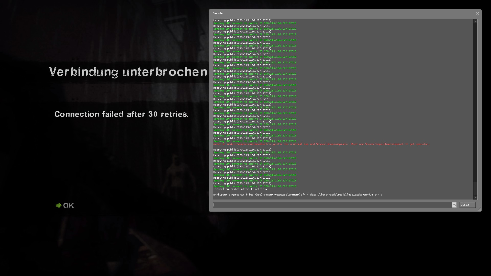
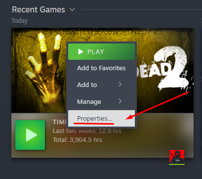
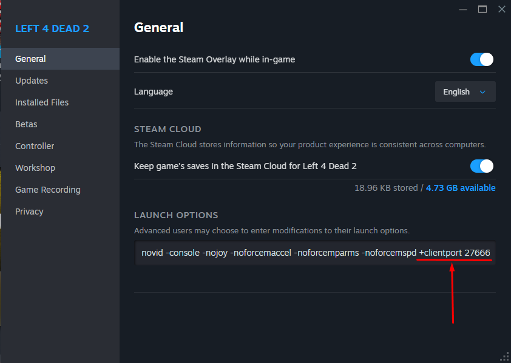

#  Left 4 Dead 2 — Fix for UDP Connect Retry Issue

- [ README em Português](README.pt.md)
- [ README en Español](README.es.md)

If you are getting the following connection error when trying to join the server:

```
Retrying public(181.214.221.198:27015)
Sending UDP connect to public IP 181.214.221.198:27015
```

<p align="center">
  
</p>

Follow these steps to solve it:

## ✅ Solution

1. **Close the game.**
2. **Open Steam**, right-click **Left 4 Dead 2** in your Library and select **Properties**.

<p align="center">
  
</p>

3. In **Launch Options**, add the following parameter:  
   ```
   +clientport 27666
   ```

    <p align="center">
    
    </p>

   - `27666` can be any number **within the range 27005–27032**.  
   - Use a different port if you still have connection issues — sometimes changing the port helps resolve conflicts with other applications.

## ✅ Important Note

To make sure the launch options work correctly, **always start the game via Steam**.

If you launch the game using a **desktop shortcut**, you must add the same launch parameters to the shortcut’s properties:

1. Right-click the **game shortcut** and select **Properties**.
2. In the **Target** field, add the parameters **after the quotes**, for example:  

```plaintext
"E:\Steam\steamapps\common\Left 4 Dead 2\left4dead2.exe" -console +clientport 27666
```

## ⚙️ Example Launch Options

Here’s an example of what my Launch Options look like:  

```
-lv +precache_all_survivors 1 -novid -console -nojoy -noforcemaccel -noforcemparms -noforcemspd +clientport 27666
```

### What do these mean?

- `-lv` — Enables Low Violence mode (may reduce gore effects).
- `+precache_all_survivors 1` — Preloads all survivor models to avoid stutters when switching characters.
- `-novid` — Skips the intro video.
- `-console` — Enables the developer console on startup.
- `-nojoy` — Disables joystick support (frees up system resources).
- `-noforcemaccel`, `-noforcemparms`, `-noforcemspd` — These ensure your mouse settings are not overridden by the game.
- `+clientport 27666` — Forces the game to use a specific local port to avoid connection conflicts.

---

## 📞 Need Help?

If the issue persists, feel free to reach out here: [https://steamcommunity.com/id/altairsossai/](https://steamcommunity.com/id/altairsossai/)

Good luck and have fun!
