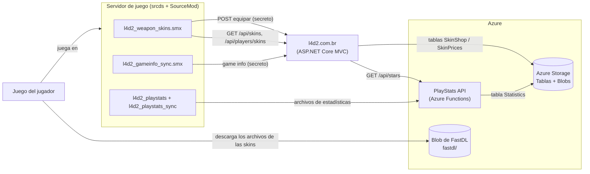
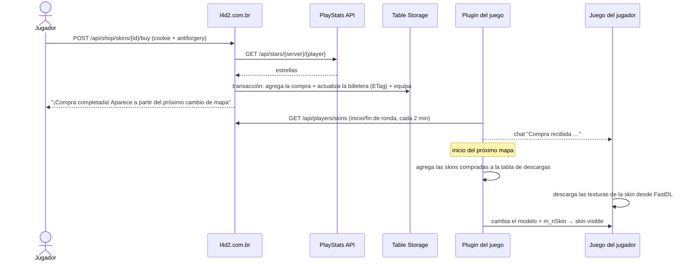

# 1. Visión general y arquitectura

🌐 [English](01-overview.md) | [Português](01-overview.pt.md) | **Español** · [Inicio de la wiki](README.es.md)

## Componentes

| Pieza | Dónde se ejecuta | Responsabilidad |
|---|---|---|
| `l4d2_playstats` / `l4d2_playstats_sync` | Servidor de juego | Escribir un archivo de estadísticas por mapa y subirlo a la API |
| PlayStats API | Azure Functions | Guardar las estadísticas, armar las partidas y el ranking, calcular las **estrellas** |
| l4d2.com.br | Servidor Linux (Kestrel en una sesión `screen`) | Catálogo de skins, tienda, reembolsos de temporada, páginas de admin, API para el plugin |
| `l4d2_weapon_skins` | Servidor de juego | Descargar solo las skins compradas, aplicarlas en el juego, sincronizar las skins equipadas |
| `l4d2_gameinfo_sync` | Servidor de juego | Enviar la información del juego y el chat en vivo al sitio |
| Repositorio de assets | Pipeline → servidor de juego + blob de FastDL | Modelos y materiales de las skins |

## Estrellas, compras y skins equipadas

- **Estrellas** = MVPs de todo el historial de un jugador (MVPs de daño a SI + MVPs de infectados comunes) en partidas **competitivas**. Son **datos derivados**: la API los calcula a partir de las estadísticas guardadas y nunca se editan a mano. Consulta [Estrellas](04-stars-api.es.md).
- **Estrellas gastadas, compras y skins equipadas** están en la tabla `SkinShop` del sitio. El saldo que ve un jugador siempre es `estrellas − gastadas`. Consulta [Tienda de skins](05-skin-shop.es.md).
- **Los precios** vienen del catálogo (`skins.json`) y los admins pueden cambiarlos en la tabla `SkinPrices`.
- **Temporadas** — una skin comprada dura hasta el próximo reinicio del ranking (00:00 UTC del día 1 de ene, mar, may, jul, sep y nov). En el reinicio, toda compra que no sea un regalo se reembolsa automáticamente: las estrellas gastadas vuelven y la skin sale de la cuenta. Los regalos se conservan para siempre. Consulta [Tienda de skins → Equipar, regalar, reembolsar](05-skin-shop.es.md#equipar-regalar-reembolsar).

## El recorrido de una compra

1. El jugador compra la skin en el sitio. El backend lee las estrellas en la API, verifica el saldo y guarda la compra, el nuevo total gastado y la skin equipada **en una única transacción atómica**.
2. El plugin actualiza las compras al inicio de la ronda, al final de la ronda y cada 2 minutos. Cuando ve una compra nueva de un jugador conectado, se lo avisa por el chat.
3. Al inicio del próximo mapa el plugin agrega los materiales de todas las skins compradas a la tabla de descargas. Todos los jugadores conectados los descargan durante la carga del mapa.
4. Cuando el dueño sostiene el arma, el plugin cambia el arma al modelo combinado y define la skin family.
5. En el próximo reinicio del ranking el sitio reembolsa la compra automáticamente (salvo que sea un regalo) y el plugin deja de ver la skin como propia en su siguiente actualización.

## ¿Por qué "próximo cambio de mapa"?

El motor Source arma la lista de archivos que los clientes deben descargar (la *tabla de descargas*) una vez por mapa, antes de que los jugadores lo carguen. Un archivo agregado en medio de un mapa no se envía a nadie hasta el siguiente mapa. Por eso:

- los **modelos** de las 15 armas siempre están en la tabla de descargas (descargar modelos durante un cambio de mapa muestra `ERROR` hasta reiniciar el juego);
- solo los **materiales** (texturas) de una skin se agregan cuando alguien la compra — las texturas se descargan sin problema en un cambio de mapa.

## Decisiones clave (y por qué)

| Decisión | Motivo |
|---|---|
| Skins de la workshop solo de textura | Sin geometría propia: todas las skins reutilizan el layout del modelo original, así un solo modelo combinado puede contenerlas todas |
| Un modelo combinado por arma, una skin family por skin | Los jugadores descargan el modelo una vez; una skin nueva solo agrega texturas |
| Solo se descargan las skins compradas | Descargas más pequeñas; el conjunto crece junto con la tienda |
| Las estrellas son derivadas, nunca se guardan como contador | No pueden desincronizarse; los admins no pueden cambiarlas |
| Las compras duran una temporada del ranking, los regalos para siempre | La tienda sigue el reinicio del ranking: las estrellas vuelven cada temporada para que los jugadores elijan de nuevo |
| Compra = una transacción en Table Storage con ETag | Sin compras dobles, sin compras sin débito, sin gastar de más con accesos simultáneos |
| El front end envía solo el id de la skin | El backend nunca confía en precios ni saldos que vengan del cliente |
| Catálogo en `skins.json`, precios modificables en una tabla | Las skins necesitan archivos y un despliegue de todos modos; los precios se pueden ajustar sin despliegue |
