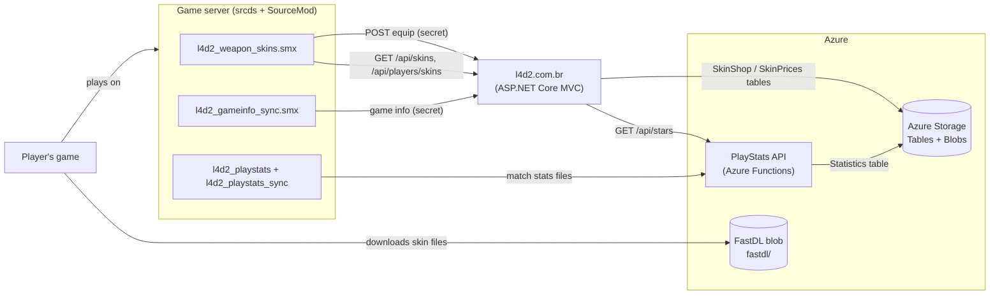
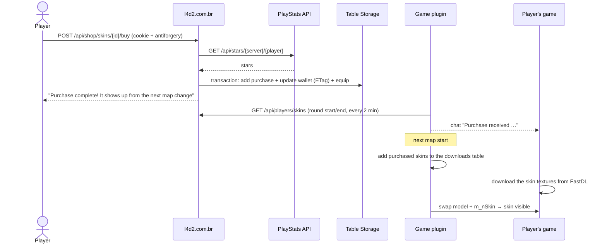

# 1. Overview & architecture

🌐 **English** | [Português](01-overview.pt.md) · [Wiki home](README.md)

## Components

| Piece | Where it runs | Responsibility |
|---|---|---|
| `l4d2_playstats` / `l4d2_playstats_sync` | Game server | Write one statistics file per map and upload it to the API |
| PlayStats API | Azure Functions | Store statistics, build matches and the ranking, compute **stars** |
| l4d2.com.br | Linux host (Kestrel in a `screen` session) | Skin catalog, shop, admin pages, plugin-facing API |
| `l4d2_weapon_skins` | Game server | Download only purchased skins, apply them in game, sync equipped skins |
| `l4d2_gameinfo_sync` | Game server | Push live game info and chat to the site |
| Assets repository | Pipeline → game server + FastDL blob | Models and materials of the skins |

## Stars, purchases and equipped skins

- **Stars** = all-time MVPs of a player (SI damage MVPs + common infected MVPs) in **competitive** matches. They are **derived data**: computed by the API from the stored match statistics, never edited by hand. See [Stars](04-stars-api.md).
- **Spent stars, purchases and equipped skins** live in the site's `SkinShop` table. The balance shown to a player is always `stars − spent`. See [Skin shop](05-skin-shop.md).
- **Prices** come from the catalog (`skins.json`) and can be overridden by admins in the `SkinPrices` table.

## Life of a purchase

1. The player buys the skin on the site. The backend reads the stars from the API, checks the balance and stores the purchase, the new spent total and the equipped skin **in one atomic transaction**.
2. The plugin refreshes the purchases on round start, round end and every 2 minutes. When it sees a new purchase of a connected player, it tells the player in chat.
3. On the next map start the plugin adds the materials of every purchased skin to the downloads table. Every connected player downloads them during the map load.
4. When the owner holds the weapon, the plugin swaps the weapon to the combined model and sets the skin family.

## Why "next map change"?

The Source engine builds the list of files that clients must download (the *downloads table*) once per map, before players load it. A file added in the middle of a map is not sent to anyone until the next map. That is why:

- the **models** of all 14 weapons are always in the downloads table (downloading models during a map change shows `ERROR` until the game restarts);
- only the **materials** (textures) of a skin are added when someone buys it — textures download fine on a map change.

## Key decisions (and why)

| Decision | Reason |
|---|---|
| Texture-only workshop skins | No custom geometry: every skin reuses the stock model layout, so one combined model can hold all of them |
| One combined model per weapon, one skin family per skin | Players download the model once; a new skin only adds textures |
| Only purchased skins are downloaded | Smaller downloads; the set grows with the shop |
| Stars are derived, never stored as a counter | They cannot drift out of sync; admins cannot change them |
| Purchase = one Table Storage transaction with an ETag | No double purchase, no purchase without debit, no overspending under concurrency |
| The front end sends only the skin id | The backend never trusts prices or balances from the client |
| Catalog in `skins.json`, prices overridable in a table | Skins need files and a deploy anyway; prices can be tuned without a deploy |
