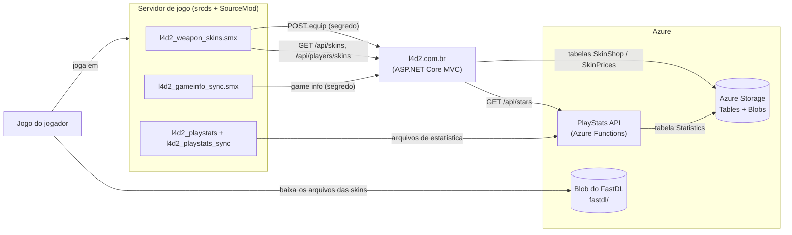
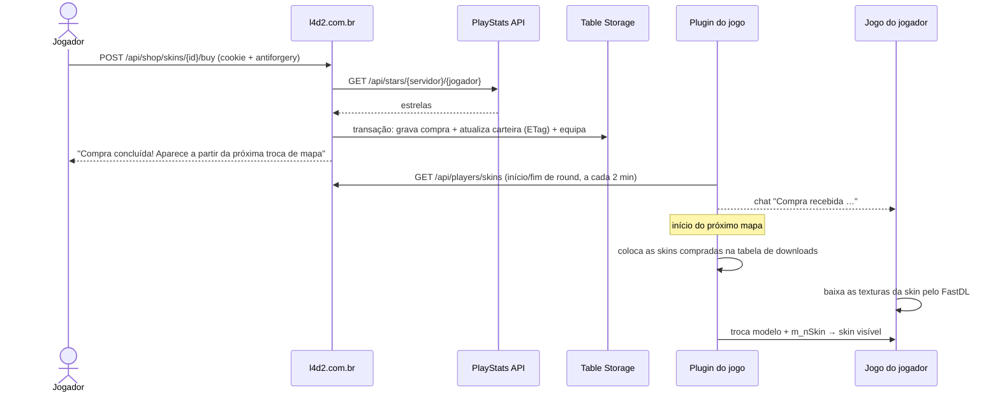

# 1. Visão geral e arquitetura

🌐 [English](01-overview.md) | **Português** · [Início da wiki](README.pt.md)

## Componentes

| Peça | Onde roda | Responsabilidade |
|---|---|---|
| `l4d2_playstats` / `l4d2_playstats_sync` | Servidor de jogo | Gravar um arquivo de estatísticas por mapa e enviá-lo para a API |
| PlayStats API | Azure Functions | Guardar estatísticas, montar partidas e ranking, calcular as **estrelas** |
| l4d2.com.br | Servidor Linux (Kestrel numa sessão `screen`) | Catálogo de skins, loja, telas de admin, API usada pelo plugin |
| `l4d2_weapon_skins` | Servidor de jogo | Baixar só as skins compradas, aplicá-las no jogo, sincronizar as skins equipadas |
| `l4d2_gameinfo_sync` | Servidor de jogo | Enviar ao site o estado do jogo e o chat em tempo real |
| Repositório de assets | Pipeline → servidor de jogo + blob do FastDL | Modelos e materiais das skins |

## Estrelas, compras e skins equipadas

- **Estrelas** = MVPs de todo o histórico de um jogador (MVPs de dano em SI + MVPs de comuns) em partidas **competitivas**. São **dados derivados**: calculados pela API a partir das estatísticas guardadas, nunca editados à mão. Veja [Estrelas](04-stars-api.pt.md).
- **Estrelas gastas, compras e skins equipadas** ficam na tabela `SkinShop` do site. O saldo mostrado ao jogador é sempre `estrelas − gastas`. Veja [Loja de skins](05-skin-shop.pt.md).
- **Preços** vêm do catálogo (`skins.json`) e podem ser alterados pelos admins na tabela `SkinPrices`.

## O caminho de uma compra

1. O jogador compra a skin no site. O back-end lê as estrelas na API, confere o saldo e grava a compra, o novo total gasto e a skin equipada **numa única transação atômica**.
2. O plugin atualiza as compras no início do round, no fim do round e a cada 2 minutos. Quando vê uma compra nova de um jogador conectado, avisa o jogador no chat.
3. No início do próximo mapa, o plugin coloca os materiais de todas as skins compradas na tabela de downloads. Todos os jogadores conectados baixam esses arquivos durante o carregamento do mapa.
4. Quando o dono segura a arma, o plugin troca a arma para o modelo combinado e define a skin family.

## Por que "próxima troca de mapa"?

O motor Source monta a lista de arquivos que os clientes precisam baixar (a *tabela de downloads*) uma vez por mapa, antes de os jogadores carregarem o mapa. Um arquivo adicionado no meio do mapa só é enviado no mapa seguinte. Por isso:

- os **modelos** das 14 armas estão sempre na tabela de downloads (baixar modelos durante a troca de mapa mostra `ERROR` até reiniciar o jogo);
- só os **materiais** (texturas) de uma skin entram quando alguém compra — texturas baixam normalmente na troca de mapa.

## Decisões principais (e por quê)

| Decisão | Motivo |
|---|---|
| Skins do Workshop só de textura | Sem geometria própria: toda skin usa o layout do modelo original, então um modelo combinado comporta todas |
| Um modelo combinado por arma, uma skin family por skin | O jogador baixa o modelo uma vez; uma skin nova só adiciona texturas |
| Só as skins compradas são baixadas | Downloads menores; o conjunto cresce com a loja |
| Estrelas são derivadas, nunca um contador gravado | Não dessincronizam; admins não conseguem alterá-las |
| Compra = uma transação no Table Storage com ETag | Sem compra duplicada, sem compra sem débito, sem gastar além do saldo em compras simultâneas |
| O front-end envia só o id da skin | O back-end nunca confia em preço ou saldo vindos do cliente |
| Catálogo no `skins.json`, preços sobrescrevíveis numa tabela | Skins exigem arquivos e deploy de qualquer forma; preços podem ser ajustados sem deploy |
