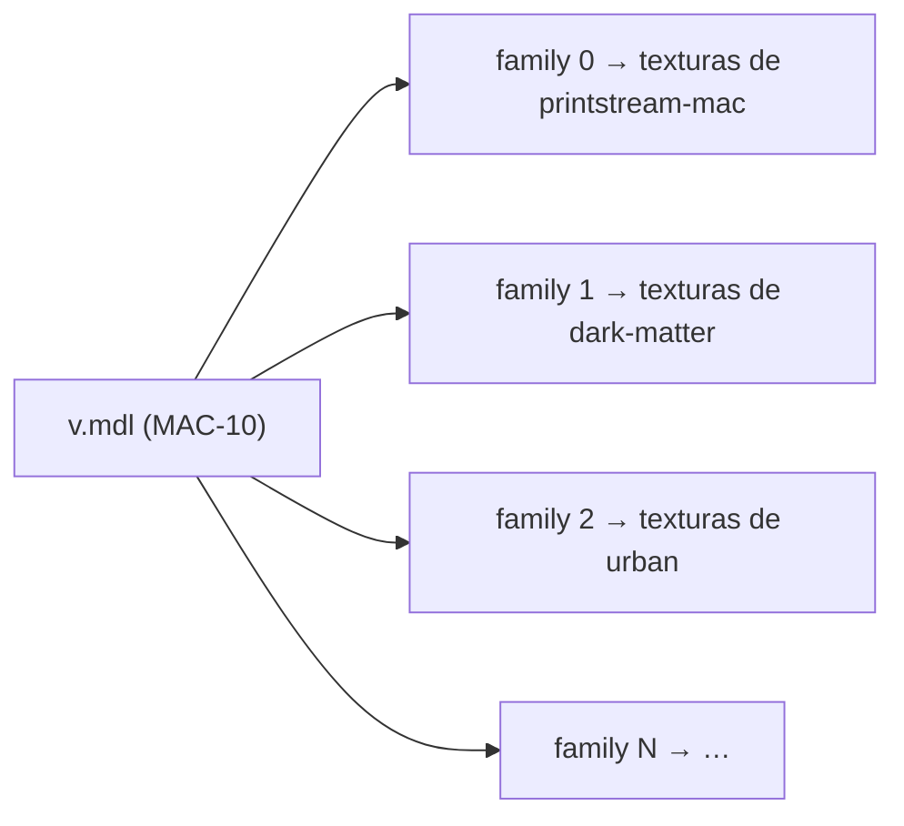

# 2. Assets de las skins

🌐 [English](02-assets.md) | [Português](02-assets.pt.md) | **Español** · [Inicio de la wiki](README.es.md)

## Skins solo de textura

Cada skin viene de un addon de la Steam Workshop **solo de textura**: reemplaza las texturas (`.vtf`) y los materiales (`.vmt`) de un arma original, pero mantiene la geometría original. Los addons que reemplazan el modelo del arma, y los addons hechos para el modelo personalizado de otro addon, se descartaron, porque:

- una skin solo de textura encaja en el layout del modelo original, así que todas las skins de un arma caben en **un modelo combinado**;
- los jugadores nunca necesitan instalar archivos `.vpk`: todo se entrega por FastDL.

El catálogo tiene **196 skins** para 15 armas (cantidad de skins entre paréntesis):

| Armas de fuego | Cuerpo a cuerpo (`weapon_melee_<script>`) |
|---|---|
| `weapon_smg` (8), `weapon_smg_silenced` (MAC-10, 30), `weapon_smg_mp5` (20), `weapon_pumpshotgun` (33), `weapon_shotgun_chrome` (34), `weapon_pistol_magnum` (Magnum / Desert Eagle, 26) | `fireaxe` (15), `katana` (7), `machete` (5), `baseball_bat` (4), `cricket_bat` (3), `electric_guitar` (6), `crowbar` (2), `golfclub` (2), `frying_pan` (1) |

El modelo combinado más grande es el de la escopeta cromada, con 34 skin families.

## Estructura de carpetas (repositorio de assets)

```
models/l4d2br/weapons/<weapon>/            ← one combined model per weapon
    v.mdl  v.vvd  v.dx90.vtx                 view model (first person)
    w.mdl  w.vvd  w.dx90.vtx                 world model (third person / ground)
materials/models/l4d2br/weapons/<weapon>_<workshopId>/   ← one folder per skin
    *.vmt  *.vtf
```

`<weapon>` es la clave del arma sin el prefijo `weapon_`: `smg_silenced`, `pistol_magnum`, `melee_katana`, …

Ejemplo — la skin **Dark Matter** de la MAC-10:

```
materials/models/l4d2br/weapons/smg_silenced_3377651383/
    smg_a.vmt   smg_a.vtf   smg_a_nrm.vtf   smg_a_worn.vmt
```

```text
VertexLitGeneric
{
$baseTexture "models/l4d2br/weapons/smg_silenced_3377651383/smg_a"
$bumpmap "models/l4d2br/weapons/smg_silenced_3377651383/smg_a_nrm"
...
}
```

Cada ruta de material apunta dentro de la carpeta de la propia skin, así las skins nunca sobrescriben archivos originales ni se pisan entre sí.

## Modelos combinados y skin families

Un `.mdl` de Source tiene una **tabla de texturas** y una **tabla de skin families**. Cada family es una fila que indica qué textura usar en cada slot de material del modelo. El `m_nSkin` de una entidad elige la fila.

El modelo combinado de un arma es el **modelo original** con esas dos tablas reconstruidas:

- la tabla de texturas lista las texturas de **todas las skins** del arma (`<carpeta>/<textura>`), con la ruta de búsqueda de materiales `models\l4d2br\weapons\`;
- la family `i` apunta todos los slots de material a las texturas de la skin `i`.



Los archivos de geometría (`.vvd`, `.dx90.vtx`) se copian del modelo original sin cambios. Los pasos de la construcción son:

1. **Extraer y reubicar** — leer el `.vpk` de la workshop, tomar los materiales que el addon reemplaza en el arma, moverlos a `materials/models/l4d2br/weapons/<weapon>_<workshopId>/` y reescribir las rutas dentro de cada `.vmt`.
2. **Optimizar las texturas** — recodificar los `.vtf` grandes a como máximo **1024 px**, convertir las texturas sin compresión (`BGR888`/`BGRA8888`) a DXT1 (sin alfa) o DXT5 (con alfa) y generar mipmaps en las texturas que no los tienen. Así las descargas son pequeñas: la mayoría de las skins pesa 0,5–2 MB, la más grande unos 14 MB.
3. **Guardar una sola vez las texturas idénticas** — cuando varias texturas dentro de la carpeta de la misma skin son idénticas, conservar una copia y hacer que los `.vmt` apunten a ella. Una skin nunca comparte archivos con otra, así que quitar una skin nunca rompe otra.
4. **Construir el modelo combinado** — modificar el `.mdl` original: renombrarlo, agregar la tabla de texturas, la ruta de búsqueda de materiales y la tabla de families, y actualizar los campos del encabezado (`numtextures`, `textureindex`, `numcdtextures`, `cdtextureindex`, `numskinfamilies`, `skinindex`, `length`).

El corazón del paso 4 (PowerShell, simplificado):

```powershell
foreach ($skin in $skins)                      # skins of this weapon, in cfg order
{
    $offset = $names.Count
    foreach ($t in $built.Textures) { $names.Add("$($skin.Folder)/$t") }
    foreach ($r in $built.Skins[0]) { $table.Add($offset + $r) }   # one family per skin
}
...
& $wr 204 $names.Count      # numtextures
& $wr 208 $textureArray     # textureindex
& $wr 212 1                 # numcdtextures  ("models\l4d2br\weapons\")
& $wr 216 $cdArray          # cdtextureindex
& $wr 224 $skins.Count      # numskinfamilies
& $wr 228 $skinTable        # skinindex
& $wr 76 $b.Count           # file length
```

> ⚠️ **El índice de la family es la posición de la skin dentro de su arma en `weapon_skins.cfg`** (más las families originales del arma, ver abajo). Agregar, quitar o reordenar skins de un arma obliga a reconstruir los modelos combinados de esa arma y a actualizar los valores de `"skin"` en el cfg.

### Families originales de las armas

Los modelos combinados (`v.mdl` y `w.mdl`) de toda arma con skins (las seis armas de fuego y las nueve armas cuerpo a cuerpo) empiezan con las **families del modelo original** y recién después vienen las skins:

| Arma | `stock_skins` | Primera family de skin |
|---|---|---|
| SMG, MAC-10, escopeta, chrome | 2 (normal y desgastada) | 2 |
| MP5 | 1 | 1 |
| Magnum | 3 | 3 |
| Bate de críquet, palanca | 2 | 2 |
| Bate de béisbol, guitarra, hacha, sartén, palo de golf, katana, machete | 1 | 1 |

Esas families apuntan a las texturas del modelo original (sus nombres y las carpetas de búsqueda de materiales se agregan al final de la tabla de texturas), así que la family `0` de un modelo combinado se ve idéntica al arma original. Eso es lo que permite usar siempre el modelo combinado en primera persona: un arma sin skin mantiene su `m_nSkin` original, y el cliente del anti-cheat puede apuntar el juego al modelo combinado y terminar con el parpadeo en los cambios de animación (ver [Plugin del juego](03-game-plugin.es.md)).

Las agrega [`scripts/add-stock-families.js`](https://github.com/altair-sossai/l4d2-zone-server-assets/blob/main/scripts/add-stock-families.js) del repositorio de assets: lee los modelos originales de los VPK del juego (primero `update/`) y reescribe los modelos combinados de mano y de mundo de cada arma. Ejecútalo después de reconstruir los modelos combinados de un arma; un modelo que ya las tiene se omite:

```bash
node scripts/add-stock-families.js "<carpeta de Left 4 Dead 2>" <zone-server>/addons/sourcemod/configs/weapon_skins.cfg
```

El valor de `"skin"` de una skin es entonces `stock_skins` + su posición dentro del arma.

## El cfg que lo une todo

[`addons/sourcemod/configs/weapon_skins.cfg`](../../addons/sourcemod/configs/weapon_skins.cfg) (repositorio zone-server):

```text
"WeaponSkins"
{
	"Weapons"
	{
		"weapon_smg_silenced"
		{
			"view_model"			"models/l4d2br/weapons/smg_silenced/v.mdl"
			"world_model"			"models/l4d2br/weapons/smg_silenced/w.mdl"
			"default_view_model"	"models/v_models/v_silenced_smg.mdl"
			"default_world_model"	"models/w_models/weapons/w_smg_a.mdl"
			"models"				"models/l4d2br/weapons/smg_silenced"
			"stock_skins"			"2"
		}
		...
	}
	"Skins"
	{
		"dark-matter" // https://steamcommunity.com/sharedfiles/filedetails/?id=3377651383
		{
			"weapon"		"weapon_smg_silenced"
			"skin"		"3"
			"materials"	"materials/models/l4d2br/weapons/smg_silenced_3377651383"
		}
		...
	}
}
```

- `Weapons` — los modelos combinados, los modelos originales que se restauran, la carpeta de modelos enviada por FastDL y `stock_skins` (cantidad de families originales al inicio de los modelos combinados).
- `Skins` — el id de la skin (el mismo id que usan el sitio y `!skin <id>`), su arma, el índice de la family y la carpeta de materiales.

## Entrega: servidor de juego + FastDL

El pipeline del repositorio de assets (`azure-pipelines.yml`, se ejecuta en cada push a `main`):

1. empaqueta `models/` y `materials/` en archivos `.tar.gz`;
2. los sube por SSH y los extrae en la carpeta del juego (`left4dead2/models`, `left4dead2/materials`) — el servidor necesita los archivos porque el plugin hace precache de los modelos y lista los archivos en la tabla de descargas;
3. sube a la cuenta de storage `l4d2playstats`: `models/` y `materials/` al contenedor `fastdl` (en `models/` y `materials/`), `fastdl/` a la raíz del contenedor `fastdl` y `assets/` al contenedor `assets`.

Los clientes descargan desde `sv_downloadurl` (el contenedor `fastdl`). Los archivos se sirven **sin comprimir** (sin `.bz2`).

## Créditos

Todas las skins fueron hechas por la comunidad de Left 4 Dead 2 y publicadas en la Steam Workshop. El README del repositorio de assets tiene la sección [Weapon skin credits](https://github.com/altair-sossai/l4d2-zone-server-assets#weapon-skin-credits), con una tabla por arma (skin, autor y enlace de la Workshop) y la lista de autores: 196 skins de 83 autores. Una skin de la Magnum, *Desert Eagle Retrowave / Synthwave*, está licenciada por su autor bajo CC BY-NC 3.0, y los créditos lo indican. La página de la tienda también avisa a los jugadores que las skins vienen de la Workshop y enlaza cada skin con su página original.

## Agregar una skin nueva (checklist)

1. Elige un addon de la workshop **solo de textura** y confirma que es para el modelo original de una de las 15 armas. Los addons que reemplazan el modelo del arma, o que están hechos para el modelo personalizado de otro addon, no encajan en el modelo combinado.
2. Lee la descripción del addon en la Workshop: si el autor pide no redistribuir ni volver a subir su trabajo, **no lo agregues** (los encargos, marcados con "[COMMS]", suelen pedirlo). Cinco skins se quitaron del catálogo por este motivo.
3. Extrae, reubica y optimiza sus materiales en `materials/models/l4d2br/weapons/<weapon>_<workshopId>/`: como máximo 1024 px, DXT1/DXT5 en lugar de formatos sin compresión, mipmaps y una sola copia de cada textura idéntica.
4. Agrega la skin a `weapon_skins.cfg` (id, arma, materiales) y **reconstruye los modelos combinados** de esa arma (y ejecuta `scripts/add-stock-families.js` después); define los índices de family en `"skin"` (`stock_skins` + posición).
5. Agrega la skin al catálogo del sitio `skins.json` (id, arma, rareza, precio, títulos/descripciones en en/pt/es) y su miniatura `wwwroot/imgs/skins/<id>.jpg`.
6. Agrega la skin a la tabla de créditos de su arma en el README de los assets (skin, autor, enlace de la Workshop), actualiza la cantidad en el título del arma y la lista de autores.
7. Vuelve a generar el manifiesto de assets del servidor del anti-cheat (ver abajo) y sube la versión del cliente.
8. Despliega en este orden: cliente del anti-cheat → assets → sitio → zone-server, y luego reinicia el servidor de juego mientras está vacío. Consulta [Operación → Cuando cambian los modelos combinados](06-operations.es.md#cuando-cambian-los-modelos-combinados).

> Los scripts usados en los pasos 3–4 se ejecutaron localmente durante el desarrollo y **todavía no están versionados** en ningún repositorio.

## Manifiesto del anti-cheat

El cliente del anti-cheat verifica los archivos de skin enviados por el servidor contra un manifiesto (`Manifest/server-assets-manifest.json` en el repositorio l4d2-anti-cheat-client). Cada vez que se agregan o cambian archivos de skin, vuelve a generarlo a partir de un checkout del repositorio de assets y publica una nueva versión del cliente:

```bash
dotnet run --project tools/L4D2AntiCheat.ManifestGenerator -- server-assets <path-to-l4d2-zone-server-assets>
```

Genéralo a partir de archivos con fin de línea **LF**: el repositorio de assets normaliza los archivos de texto (`.vmt`) a LF, y eso es lo que reciben el servidor y FastDL.

El cliente nuevo debe publicarse **antes** que los assets: un jugador cuyo cliente todavía tiene el manifiesto anterior y que descarga los archivos nuevos es expulsado por el anti-cheat.
