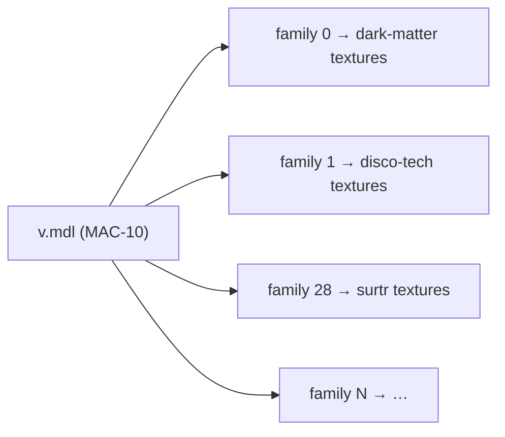

# 2. Skin assets

🌐 **English** | [Português](02-assets.pt.md) · [Wiki home](README.md)

## Texture-only skins

Every skin comes from a **texture-only** Steam Workshop addon: it replaces the textures (`.vtf`) and materials (`.vmt`) of a stock weapon but keeps the stock geometry. Addons that replace the model itself were rejected, because:

- a texture-only skin fits the stock model layout, so all skins of a weapon can live in **one combined model**;
- players never need to install `.vpk` files: everything is delivered through FastDL.

The catalog has **171 skins** for 14 weapons:

| Firearms | Melee (`weapon_melee_<script>`) |
|---|---|
| `weapon_smg`, `weapon_smg_silenced` (MAC-10), `weapon_smg_mp5`, `weapon_pumpshotgun`, `weapon_shotgun_chrome` | `fireaxe`, `katana`, `machete`, `baseball_bat`, `cricket_bat`, `electric_guitar`, `crowbar`, `golfclub`, `frying_pan` |

## Folder layout (assets repository)

```
models/l4d2br/weapons/<weapon>/            ← one combined model per weapon
    v.mdl  v.vvd  v.dx90.vtx                 view model (first person)
    w.mdl  w.vvd  w.dx90.vtx                 world model (third person / ground)
materials/models/l4d2br/weapons/<weapon>_<workshopId>/   ← one folder per skin
    *.vmt  *.vtf
```

Example — the **Surtr** MAC-10 skin:

```
materials/models/l4d2br/weapons/smg_silenced_2845730284/
    smg_a.vmt   smg_a.vtf   smg_a_bump.vtf   smg_a_worn.vmt   mask.vtf
```

```text
VertexLitGeneric
{
$baseTexture "models/l4d2br/weapons/smg_silenced_2845730284/smg_a"
$bumpmap "models/l4d2br/weapons/smg_silenced_2845730284/smg_a_bump"
$selfillummask "models/l4d2br/weapons/smg_silenced_2845730284/mask"
...
}
```

Every material path points inside the skin's own folder, so skins never overwrite stock files or each other.

## Combined models and skin families

A Source `.mdl` has a **texture table** and a **skin family table**. Each family is a row that says which texture to use for every material slot of the model. `m_nSkin` on an entity selects the row.

The combined model of a weapon is the **stock model** with those two tables rebuilt:

- the texture table lists the textures of **every skin** of the weapon (`<folder>/<texture>`), with the material search path `models\l4d2br\weapons\`;
- family `i` points every material slot to the textures of skin `i`.



Geometry files (`.vvd`, `.dx90.vtx`) are copied from the stock model unchanged. The build steps are:

1. **Extract & relocate** — read the workshop `.vpk`, take the materials that the addon overrides for the weapon, move them to `materials/models/l4d2br/weapons/<weapon>_<workshopId>/` and rewrite the paths inside each `.vmt`.
2. **Shrink textures** — re-encode large `.vtf` files to at most **1024 px**, DXT1 (no alpha) or DXT5 (alpha), with mipmaps. This keeps every skin download small (0.5–3 MB).
3. **Build the combined model** — patch the stock `.mdl`: rename it, append the texture table, the material search path and the family table, and update the header fields (`numtextures`, `textureindex`, `numcdtextures`, `cdtextureindex`, `numskinfamilies`, `skinindex`, `length`).

The heart of step 3 (PowerShell, simplified):

```powershell
foreach ($skin in $skins)                      # skins of this weapon, in cfg order
{
    $offset = $names.Count
    foreach ($t in $built.Textures) { $names.Add("$($skin.Folder)/$t") }
    foreach ($r in $built.Skins[0]) { $table.Add($offset + $r) }   # one family per skin
}
...
& $wr 204 $names.Count      # numtextures
& $wr 208 $textureArray     # textureindex
& $wr 212 1                 # numcdtextures  ("models\l4d2br\weapons\")
& $wr 216 $cdArray          # cdtextureindex
& $wr 224 $skins.Count      # numskinfamilies
& $wr 228 $skinTable        # skinindex
& $wr 76 $b.Count           # file length
```

> ⚠️ **The family index is the position of the skin inside its weapon in `weapon_skins.cfg`.** Adding, removing or reordering skins of a weapon means rebuilding that weapon's combined models and updating the `"skin"` values in the cfg.

## The cfg that ties it together

`addons/sourcemod/configs/weapon_skins.cfg` (zone-server repository):

```text
"WeaponSkins"
{
	"Weapons"
	{
		"weapon_smg_silenced"
		{
			"view_model"			"models/l4d2br/weapons/smg_silenced/v.mdl"
			"world_model"			"models/l4d2br/weapons/smg_silenced/w.mdl"
			"default_view_model"	"models/v_models/v_silenced_smg.mdl"
			"default_world_model"	"models/w_models/weapons/w_smg_a.mdl"
			"models"				"models/l4d2br/weapons/smg_silenced"
		}
		...
	}
	"Skins"
	{
		"surtr" // https://steamcommunity.com/sharedfiles/filedetails/?id=2845730284
		{
			"weapon"		"weapon_smg_silenced"
			"skin"		"28"
			"materials"	"materials/models/l4d2br/weapons/smg_silenced_2845730284"
		}
		...
	}
}
```

- `Weapons` — combined models, the stock models to restore, and the model folder sent through FastDL.
- `Skins` — the skin id (the same id used by the site and by `!skin <id>`), its weapon, family index and materials folder.

## Delivery: game server + FastDL

The assets repository pipeline (`azure-pipelines.yml`, runs on every push to `main`):

1. packs `models/` and `materials/` into `.tar.gz` files;
2. uploads them over SSH and extracts them into the game folder (`left4dead2/models`, `left4dead2/materials`) — the server needs the files because the plugin precaches models and lists files in the downloads table;
3. uploads `models/`, `materials/`, `fastdl/` and `assets/` to the `l4d2playstats` storage account (`fastdl` and `assets` containers).

Clients download from `sv_downloadurl` (the `fastdl` container). Files are served **uncompressed** (no `.bz2`).

## Adding a new skin (checklist)

1. Pick a **texture-only** workshop addon and confirm it targets one of the 14 weapons.
2. Extract, relocate and shrink its materials into `materials/models/l4d2br/weapons/<weapon>_<workshopId>/`.
3. Add the skin to `weapon_skins.cfg` (id, weapon, materials) and **rebuild the combined models** of that weapon; set the `"skin"` family indexes.
4. Add the skin to the site catalog `skins.json` (id, weapon, rarity, price, titles/descriptions in en/pt/es) and its thumbnail `wwwroot/imgs/skins/<id>.jpg`.
5. Regenerate the anti-cheat server assets manifest (see below) and release a new client.
6. Push the assets repository first, then zone-server and the site. **Restart the game server** after the assets deploy: a changed model must be downloaded on connect, not on a map change.

> The scripts used for steps 2–3 were run locally during development and are **not versioned** in any repository yet.

## Anti-cheat manifest

The anti-cheat client keeps a manifest with the hashes of the server assets (`Manifest/server-assets-manifest.json` in the l4d2-anti-cheat-client repository). Whenever skin files are added or changed, regenerate it from a checkout of the assets repository and release a new client:

```bash
dotnet run --project tools/L4D2AntiCheat.ManifestGenerator -- server-assets <path-to-l4d2-zone-server-assets>
```

Generate it from files with **LF** line endings: the assets repository normalizes text files (`.vmt`) to LF, and that is what the server and FastDL receive.
