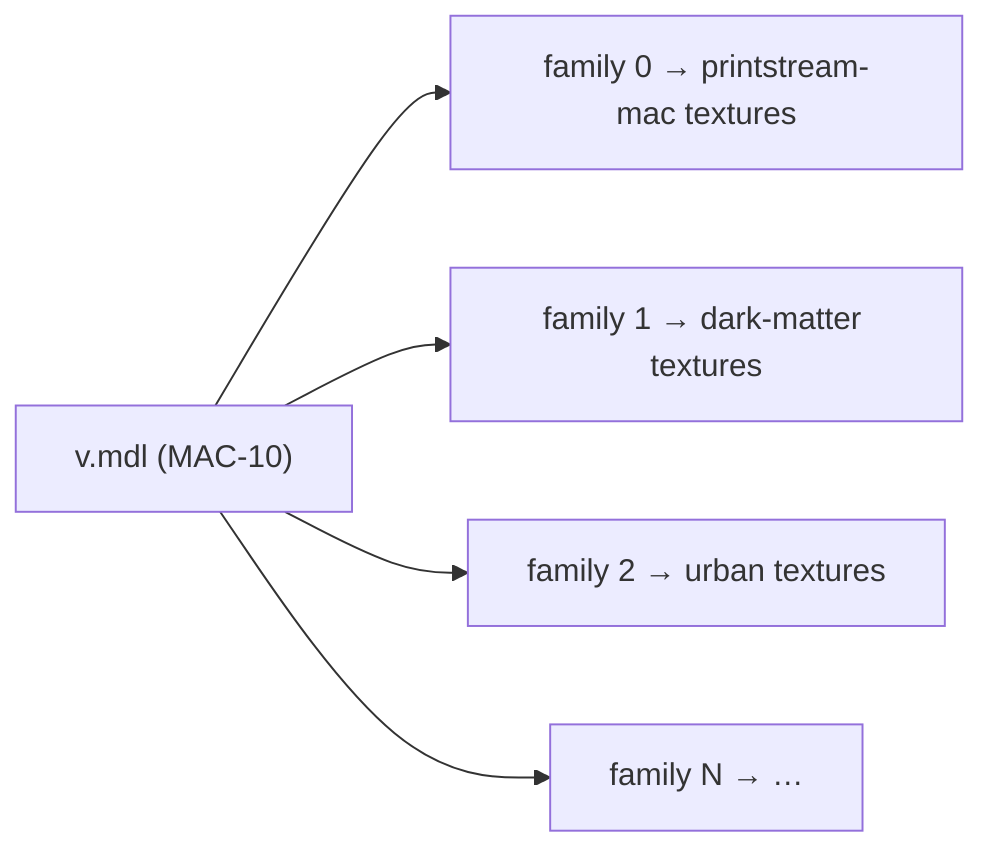

# 2. Skin assets

🌐 **English** | [Português](02-assets.pt.md) | [Español](02-assets.es.md) · [Wiki home](README.md)

## Texture-only skins

Every skin comes from a **texture-only** Steam Workshop addon: it replaces the textures (`.vtf`) and materials (`.vmt`) of a stock weapon but keeps the stock geometry. Addons that replace the gun model, and addons made for another addon's custom model, were rejected, because:

- a texture-only skin fits the stock model layout, so all skins of a weapon can live in **one combined model**;
- players never need to install `.vpk` files: everything is delivered through FastDL.

The catalog has **196 skins** for 15 weapons (number of skins in parentheses):

| Firearms | Melee (`weapon_melee_<script>`) |
|---|---|
| `weapon_smg` (8), `weapon_smg_silenced` (MAC-10, 30), `weapon_smg_mp5` (20), `weapon_pumpshotgun` (33), `weapon_shotgun_chrome` (34), `weapon_pistol_magnum` (Magnum / Desert Eagle, 26) | `fireaxe` (15), `katana` (7), `machete` (5), `baseball_bat` (4), `cricket_bat` (3), `electric_guitar` (6), `crowbar` (2), `golfclub` (2), `frying_pan` (1) |

The largest combined model is the chrome shotgun's, with 34 skin families.

## Folder layout (assets repository)

```
models/l4d2br/weapons/<weapon>/            ← one combined model per weapon
    v.mdl  v.vvd  v.dx90.vtx                 view model (first person)
    w.mdl  w.vvd  w.dx90.vtx                 world model (third person / ground)
materials/models/l4d2br/weapons/<weapon>_<workshopId>/   ← one folder per skin
    *.vmt  *.vtf
```

`<weapon>` is the weapon key without the `weapon_` prefix: `smg_silenced`, `pistol_magnum`, `melee_katana`, …

Example — the **Dark Matter** MAC-10 skin:

```
materials/models/l4d2br/weapons/smg_silenced_3377651383/
    smg_a.vmt   smg_a.vtf   smg_a_nrm.vtf   smg_a_worn.vmt
```

```text
VertexLitGeneric
{
$baseTexture "models/l4d2br/weapons/smg_silenced_3377651383/smg_a"
$bumpmap "models/l4d2br/weapons/smg_silenced_3377651383/smg_a_nrm"
...
}
```

Every material path points inside the skin's own folder, so skins never overwrite stock files or each other.

## Combined models and skin families

A Source `.mdl` has a **texture table** and a **skin family table**. Each family is a row that says which texture to use for every material slot of the model. `m_nSkin` on an entity selects the row.

The combined model of a weapon is the **stock model** with those two tables rebuilt:

- the texture table lists the textures of **every skin** of the weapon (`<folder>/<texture>`), with the material search path `models\l4d2br\weapons\`;
- family `i` points every material slot to the textures of skin `i`.



Geometry files (`.vvd`, `.dx90.vtx`) are copied from the stock model unchanged. The build steps are:

1. **Extract & relocate** — read the workshop `.vpk`, take the materials that the addon overrides for the weapon, move them to `materials/models/l4d2br/weapons/<weapon>_<workshopId>/` and rewrite the paths inside each `.vmt`.
2. **Optimize textures** — re-encode large `.vtf` files to at most **1024 px**, convert uncompressed textures (`BGR888`/`BGRA8888`) to DXT1 (no alpha) or DXT5 (alpha), and generate mipmaps for textures that have none. This keeps skin downloads small: most skins are 0.5–2 MB, the largest about 14 MB.
3. **Store identical textures once** — when several textures inside the same skin folder are identical, keep one copy and point the `.vmt` files to it. Skins never share files with other skins, so removing one skin never breaks another.
4. **Build the combined model** — patch the stock `.mdl`: rename it, append the texture table, the material search path and the family table, and update the header fields (`numtextures`, `textureindex`, `numcdtextures`, `cdtextureindex`, `numskinfamilies`, `skinindex`, `length`).

The heart of step 4 (PowerShell, simplified):

```powershell
foreach ($skin in $skins)                      # skins of this weapon, in cfg order
{
    $offset = $names.Count
    foreach ($t in $built.Textures) { $names.Add("$($skin.Folder)/$t") }
    foreach ($r in $built.Skins[0]) { $table.Add($offset + $r) }   # one family per skin
}
...
& $wr 204 $names.Count      # numtextures
& $wr 208 $textureArray     # textureindex
& $wr 212 1                 # numcdtextures  ("models\l4d2br\weapons\")
& $wr 216 $cdArray          # cdtextureindex
& $wr 224 $skins.Count      # numskinfamilies
& $wr 228 $skinTable        # skinindex
& $wr 76 $b.Count           # file length
```

> ⚠️ **The family index is the position of the skin inside its weapon in `weapon_skins.cfg`.** Adding, removing or reordering skins of a weapon means rebuilding that weapon's combined models and updating the `"skin"` values in the cfg.

## The cfg that ties it together

[`addons/sourcemod/configs/weapon_skins.cfg`](../../addons/sourcemod/configs/weapon_skins.cfg) (zone-server repository):

```text
"WeaponSkins"
{
	"Weapons"
	{
		"weapon_smg_silenced"
		{
			"view_model"			"models/l4d2br/weapons/smg_silenced/v.mdl"
			"world_model"			"models/l4d2br/weapons/smg_silenced/w.mdl"
			"default_view_model"	"models/v_models/v_silenced_smg.mdl"
			"default_world_model"	"models/w_models/weapons/w_smg_a.mdl"
			"models"				"models/l4d2br/weapons/smg_silenced"
		}
		...
	}
	"Skins"
	{
		"dark-matter" // https://steamcommunity.com/sharedfiles/filedetails/?id=3377651383
		{
			"weapon"		"weapon_smg_silenced"
			"skin"		"1"
			"materials"	"materials/models/l4d2br/weapons/smg_silenced_3377651383"
		}
		...
	}
}
```

- `Weapons` — combined models, the stock models to restore, and the model folder sent through FastDL.
- `Skins` — the skin id (the same id used by the site and by `!skin <id>`), its weapon, family index and materials folder.

## Delivery: game server + FastDL

The assets repository pipeline (`azure-pipelines.yml`, runs on every push to `main`):

1. packs `models/` and `materials/` into `.tar.gz` files;
2. uploads them over SSH and extracts them into the game folder (`left4dead2/models`, `left4dead2/materials`) — the server needs the files because the plugin precaches models and lists files in the downloads table;
3. uploads to the `l4d2playstats` storage account: `models/` and `materials/` to the `fastdl` container (under `models/` and `materials/`), `fastdl/` to the root of the `fastdl` container and `assets/` to the `assets` container.

Clients download from `sv_downloadurl` (the `fastdl` container). Files are served **uncompressed** (no `.bz2`).

## Credits

Every skin was made by the Left 4 Dead 2 community and published on the Steam Workshop. The README of the assets repository has a [Weapon skin credits](https://github.com/altair-sossai/l4d2-zone-server-assets#weapon-skin-credits) section with one table per weapon (skin, author and Workshop link) and the list of authors: 196 skins from 83 authors. One Magnum skin, *Desert Eagle Retrowave / Synthwave*, is licensed by its author under CC BY-NC 3.0, and the credits say so. The shop page also tells players that the skins come from the Workshop and links each skin to its original page.

## Adding a new skin (checklist)

1. Pick a **texture-only** workshop addon and confirm it targets the stock model of one of the 15 weapons. Addons that replace the gun model, or that are made for another addon's custom model, do not fit the combined model.
2. Read the addon's Workshop description: if the author asks not to redistribute or re-upload the work, **do not add it** (commissioned items, marked "[COMMS]", usually ask this). Five skins were removed from the catalog for this reason.
3. Extract, relocate and optimize its materials into `materials/models/l4d2br/weapons/<weapon>_<workshopId>/`: at most 1024 px, DXT1/DXT5 instead of uncompressed formats, mipmaps, and one copy of each identical texture.
4. Add the skin to `weapon_skins.cfg` (id, weapon, materials) and **rebuild the combined models** of that weapon; set the `"skin"` family indexes.
5. Add the skin to the site catalog `skins.json` (id, weapon, rarity, price, titles/descriptions in en/pt/es) and its thumbnail `wwwroot/imgs/skins/<id>.jpg`.
6. Add the skin to the credits table of its weapon in the assets README (skin, author, Workshop link), update the count in the weapon heading and the list of authors.
7. Regenerate the anti-cheat server assets manifest (see below) and bump the client version.
8. Deploy in this order: anti-cheat client → assets → site → zone-server, then restart the game server while it is empty. See [Operations → When the combined models change](06-operations.md#when-the-combined-models-change).

> The scripts used for steps 3–4 were run locally during development and are **not versioned** in any repository yet.

## Anti-cheat manifest

The anti-cheat client verifies the skin files sent by the server against a manifest (`Manifest/server-assets-manifest.json` in the l4d2-anti-cheat-client repository). Whenever skin files are added or changed, regenerate it from a checkout of the assets repository and publish a new client version:

```bash
dotnet run --project tools/L4D2AntiCheat.ManifestGenerator -- server-assets <path-to-l4d2-zone-server-assets>
```

Generate it from files with **LF** line endings: the assets repository normalizes text files (`.vmt`) to LF, and that is what the server and FastDL receive.

The new client must be published **before** the assets: a player whose client still has the old manifest and downloads the new files is kicked by the anti-cheat.
