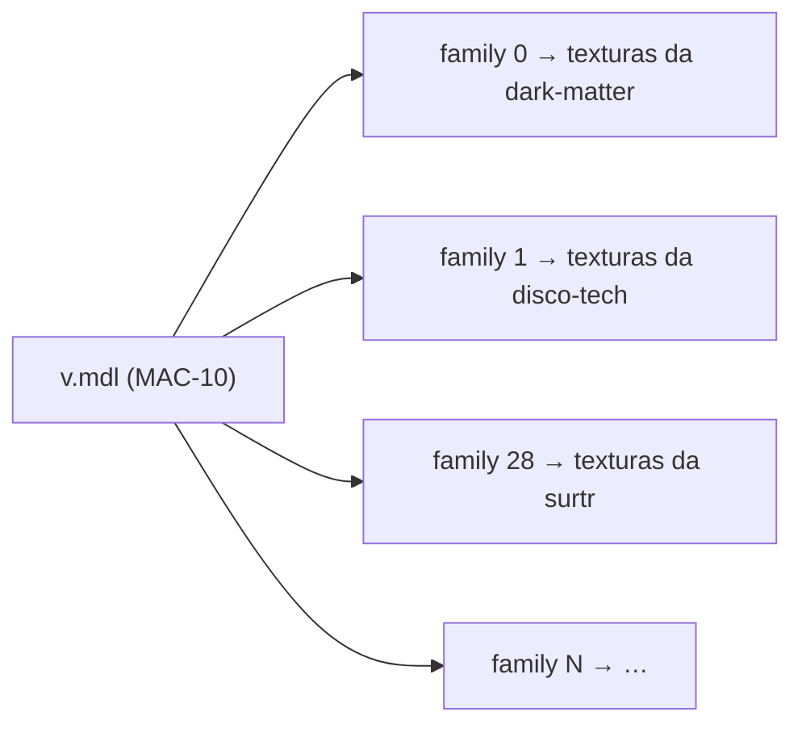

# 2. Assets das skins

🌐 [English](02-assets.md) | **Português** · [Início da wiki](README.pt.md)

## Skins só de textura

Toda skin vem de um addon do Steam Workshop **só de textura**: ele troca as texturas (`.vtf`) e os materiais (`.vmt`) de uma arma original, mas mantém a geometria original. Addons que trocam o próprio modelo foram recusados, porque:

- uma skin só de textura se encaixa no layout do modelo original, então todas as skins de uma arma cabem em **um modelo combinado**;
- os jogadores nunca precisam instalar arquivos `.vpk`: tudo é entregue pelo FastDL.

O catálogo tem **171 skins** para 14 armas:

| Armas de fogo | Armas brancas (`weapon_melee_<script>`) |
|---|---|
| `weapon_smg`, `weapon_smg_silenced` (MAC-10), `weapon_smg_mp5`, `weapon_pumpshotgun`, `weapon_shotgun_chrome` | `fireaxe`, `katana`, `machete`, `baseball_bat`, `cricket_bat`, `electric_guitar`, `crowbar`, `golfclub`, `frying_pan` |

## Estrutura de pastas (repositório de assets)

```
models/l4d2br/weapons/<arma>/              ← um modelo combinado por arma
    v.mdl  v.vvd  v.dx90.vtx                 modelo de visão (primeira pessoa)
    w.mdl  w.vvd  w.dx90.vtx                 modelo de mundo (terceira pessoa / chão)
materials/models/l4d2br/weapons/<arma>_<workshopId>/     ← uma pasta por skin
    *.vmt  *.vtf
```

Exemplo — a skin **Surtr** da MAC-10:

```
materials/models/l4d2br/weapons/smg_silenced_2845730284/
    smg_a.vmt   smg_a.vtf   smg_a_bump.vtf   smg_a_worn.vmt   mask.vtf
```

```text
VertexLitGeneric
{
$baseTexture "models/l4d2br/weapons/smg_silenced_2845730284/smg_a"
$bumpmap "models/l4d2br/weapons/smg_silenced_2845730284/smg_a_bump"
$selfillummask "models/l4d2br/weapons/smg_silenced_2845730284/mask"
...
}
```

Todo caminho de material aponta para dentro da pasta da própria skin, então as skins nunca sobrescrevem arquivos originais nem umas às outras.

## Modelos combinados e skin families

Um `.mdl` do Source tem uma **tabela de texturas** e uma **tabela de skin families**. Cada family é uma linha que diz qual textura usar em cada slot de material do modelo. O `m_nSkin` de uma entidade escolhe a linha.

O modelo combinado de uma arma é o **modelo original** com essas duas tabelas refeitas:

- a tabela de texturas lista as texturas de **todas as skins** da arma (`<pasta>/<textura>`), com o caminho de busca de materiais `models\l4d2br\weapons\`;
- a family `i` aponta todos os slots de material para as texturas da skin `i`.



Os arquivos de geometria (`.vvd`, `.dx90.vtx`) são copiados do modelo original sem mudanças. Os passos da montagem são:

1. **Extrair e realocar** — ler o `.vpk` do Workshop, pegar os materiais que o addon substitui para a arma, movê-los para `materials/models/l4d2br/weapons/<arma>_<workshopId>/` e reescrever os caminhos dentro de cada `.vmt`.
2. **Reduzir as texturas** — recodificar os `.vtf` grandes para no máximo **1024 px**, em DXT1 (sem alfa) ou DXT5 (com alfa), com mipmaps. Assim cada skin tem um download pequeno (0,5 a 3 MB).
3. **Montar o modelo combinado** — alterar o `.mdl` original: renomeá-lo, acrescentar a tabela de texturas, o caminho de busca de materiais e a tabela de families, e atualizar os campos do cabeçalho (`numtextures`, `textureindex`, `numcdtextures`, `cdtextureindex`, `numskinfamilies`, `skinindex`, `length`).

O núcleo do passo 3 (PowerShell, simplificado):

```powershell
foreach ($skin in $skins)                      # skins desta arma, na ordem do cfg
{
    $offset = $names.Count
    foreach ($t in $built.Textures) { $names.Add("$($skin.Folder)/$t") }
    foreach ($r in $built.Skins[0]) { $table.Add($offset + $r) }   # uma family por skin
}
...
& $wr 204 $names.Count      # numtextures
& $wr 208 $textureArray     # textureindex
& $wr 212 1                 # numcdtextures  ("models\l4d2br\weapons\")
& $wr 216 $cdArray          # cdtextureindex
& $wr 224 $skins.Count      # numskinfamilies
& $wr 228 $skinTable        # skinindex
& $wr 76 $b.Count           # tamanho do arquivo
```

> ⚠️ **O índice da family é a posição da skin dentro da sua arma no `weapon_skins.cfg`.** Adicionar, remover ou reordenar skins de uma arma exige remontar os modelos combinados dessa arma e atualizar os valores `"skin"` do cfg.

## O cfg que liga tudo

`addons/sourcemod/configs/weapon_skins.cfg` (repositório zone-server):

```text
"WeaponSkins"
{
	"Weapons"
	{
		"weapon_smg_silenced"
		{
			"view_model"			"models/l4d2br/weapons/smg_silenced/v.mdl"
			"world_model"			"models/l4d2br/weapons/smg_silenced/w.mdl"
			"default_view_model"	"models/v_models/v_silenced_smg.mdl"
			"default_world_model"	"models/w_models/weapons/w_smg_a.mdl"
			"models"				"models/l4d2br/weapons/smg_silenced"
		}
		...
	}
	"Skins"
	{
		"surtr" // https://steamcommunity.com/sharedfiles/filedetails/?id=2845730284
		{
			"weapon"		"weapon_smg_silenced"
			"skin"		"28"
			"materials"	"materials/models/l4d2br/weapons/smg_silenced_2845730284"
		}
		...
	}
}
```

- `Weapons` — os modelos combinados, os modelos originais para restaurar e a pasta de modelos enviada pelo FastDL.
- `Skins` — o id da skin (o mesmo id usado pelo site e pelo `!skin <id>`), sua arma, o índice da family e a pasta de materiais.

## Entrega: servidor de jogo + FastDL

A pipeline do repositório de assets (`azure-pipelines.yml`, roda a cada push na `main`):

1. empacota `models/` e `materials/` em arquivos `.tar.gz`;
2. envia por SSH e extrai na pasta do jogo (`left4dead2/models`, `left4dead2/materials`) — o servidor precisa dos arquivos porque o plugin faz precache dos modelos e lista os arquivos na tabela de downloads;
3. envia `models/`, `materials/`, `fastdl/` e `assets/` para a conta de storage `l4d2playstats` (containers `fastdl` e `assets`).

Os clientes baixam do `sv_downloadurl` (o container `fastdl`). Os arquivos são servidos **sem compressão** (sem `.bz2`).

## Adicionando uma skin nova (checklist)

1. Escolha um addon do Workshop **só de textura** e confirme que ele é de uma das 14 armas.
2. Extraia, realoque e reduza os materiais para `materials/models/l4d2br/weapons/<arma>_<workshopId>/`.
3. Adicione a skin no `weapon_skins.cfg` (id, arma, materiais) e **remonte os modelos combinados** dessa arma; defina os índices `"skin"` das families.
4. Adicione a skin no catálogo do site `skins.json` (id, arma, raridade, preço, títulos/descrições em en/pt/es) e a miniatura `wwwroot/imgs/skins/<id>.jpg`.
5. Gere de novo o manifesto de assets do servidor do anti-cheat (abaixo) e publique uma versão nova do cliente.
6. Faça o push do repositório de assets primeiro, depois do zone-server e do site. **Reinicie o servidor de jogo** depois do deploy dos assets: um modelo alterado precisa ser baixado na conexão, não na troca de mapa.

> Os scripts usados nos passos 2 e 3 foram rodados localmente durante o desenvolvimento e **ainda não estão versionados** em nenhum repositório.

## Manifesto do anti-cheat

O cliente do anti-cheat mantém um manifesto com os hashes dos assets do servidor (`Manifest/server-assets-manifest.json` no repositório l4d2-anti-cheat-client). Sempre que arquivos de skin forem adicionados ou alterados, gere o manifesto de novo a partir de um checkout do repositório de assets e publique uma versão nova do cliente:

```bash
dotnet run --project tools/L4D2AntiCheat.ManifestGenerator -- server-assets <caminho-do-l4d2-zone-server-assets>
```

Gere a partir de arquivos com finais de linha **LF**: o repositório de assets normaliza os arquivos de texto (`.vmt`) para LF, e é isso que o servidor e o FastDL recebem.
