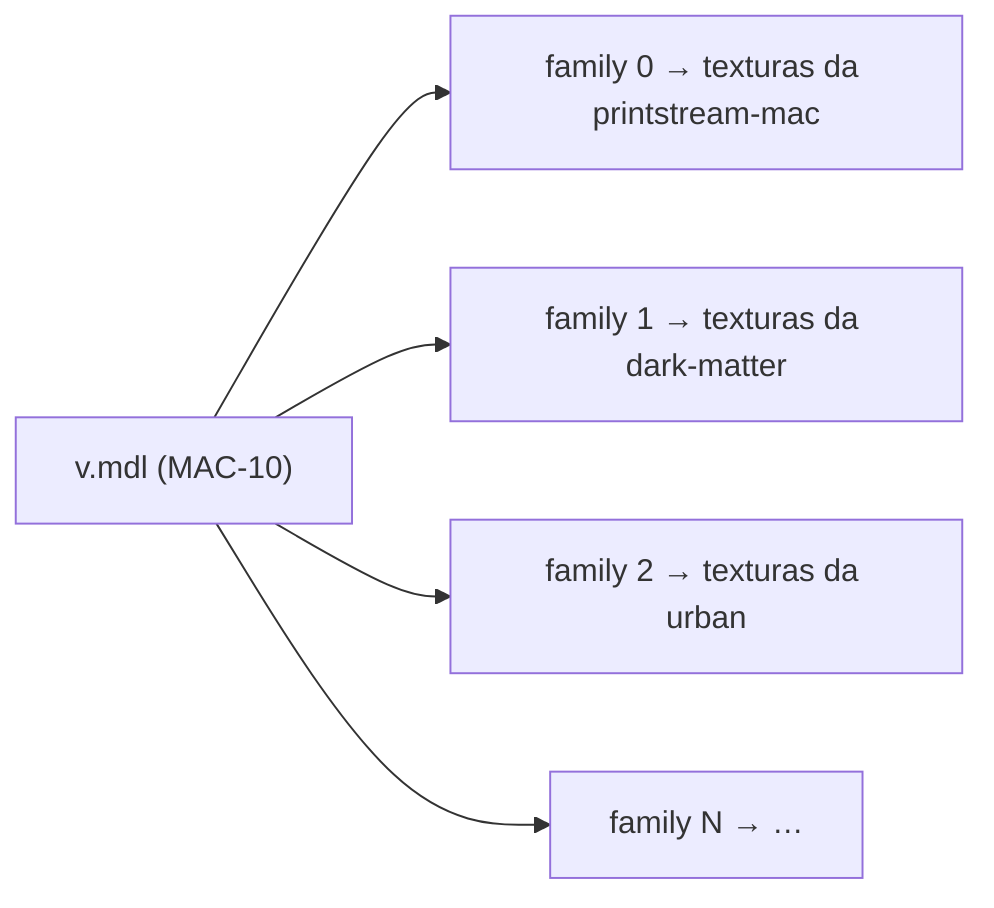

# 2. Assets das skins

🌐 [English](02-assets.md) | **Português** | [Español](02-assets.es.md) · [Início da wiki](README.pt.md)

## Skins só de textura

Toda skin vem de um addon da Steam Workshop **só de textura**: ele troca as texturas (`.vtf`) e os materiais (`.vmt`) de uma arma original, mas mantém a geometria original. Addons que trocam o modelo da arma, e addons feitos para o modelo customizado de outro addon, foram descartados, porque:

- uma skin só de textura encaixa no layout do modelo original, então todas as skins de uma arma cabem em **um modelo combinado**;
- os jogadores nunca precisam instalar arquivos `.vpk`: tudo é entregue pelo FastDL.

O catálogo tem **196 skins** para 15 armas (quantidade de skins entre parênteses):

| Armas de fogo | Armas brancas (`weapon_melee_<script>`) |
|---|---|
| `weapon_smg` (8), `weapon_smg_silenced` (MAC-10, 30), `weapon_smg_mp5` (20), `weapon_pumpshotgun` (33), `weapon_shotgun_chrome` (34), `weapon_pistol_magnum` (Magnum / Desert Eagle, 26) | `fireaxe` (15), `katana` (7), `machete` (5), `baseball_bat` (4), `cricket_bat` (3), `electric_guitar` (6), `crowbar` (2), `golfclub` (2), `frying_pan` (1) |

O maior modelo combinado é o da escopeta cromada, com 34 skin families.

## Estrutura de pastas (repositório de assets)

```
models/l4d2br/weapons/<weapon>/            ← um modelo combinado por arma
    v.mdl  v.vvd  v.dx90.vtx                 modelo de visão (primeira pessoa)
    w.mdl  w.vvd  w.dx90.vtx                 modelo de mundo (terceira pessoa / chão)
materials/models/l4d2br/weapons/<weapon>_<workshopId>/   ← uma pasta por skin
    *.vmt  *.vtf
```

`<weapon>` é a chave da arma sem o prefixo `weapon_`: `smg_silenced`, `pistol_magnum`, `melee_katana`, …

Exemplo — a skin **Dark Matter** da MAC-10:

```
materials/models/l4d2br/weapons/smg_silenced_3377651383/
    smg_a.vmt   smg_a.vtf   smg_a_nrm.vtf   smg_a_worn.vmt
```

```text
VertexLitGeneric
{
$baseTexture "models/l4d2br/weapons/smg_silenced_3377651383/smg_a"
$bumpmap "models/l4d2br/weapons/smg_silenced_3377651383/smg_a_nrm"
...
}
```

Todo caminho de material aponta para dentro da pasta da própria skin, então as skins nunca sobrescrevem arquivos originais nem umas às outras.

## Modelos combinados e skin families

Um `.mdl` do Source tem uma **tabela de texturas** e uma **tabela de skin families**. Cada family é uma linha que diz qual textura usar em cada slot de material do modelo. O `m_nSkin` de uma entidade escolhe a linha.

O modelo combinado de uma arma é o **modelo original** com essas duas tabelas refeitas:

- a tabela de texturas lista as texturas de **todas as skins** da arma (`<pasta>/<textura>`), com o caminho de busca de materiais `models\l4d2br\weapons\`;
- a family `i` aponta todos os slots de material para as texturas da skin `i`.



Os arquivos de geometria (`.vvd`, `.dx90.vtx`) são copiados do modelo original sem alteração. Os passos da montagem são:

1. **Extrair e realocar** — ler o `.vpk` da workshop, pegar os materiais que o addon substitui na arma, mover para `materials/models/l4d2br/weapons/<weapon>_<workshopId>/` e reescrever os caminhos dentro de cada `.vmt`.
2. **Otimizar as texturas** — recodificar os `.vtf` grandes para no máximo **1024 px**, converter as texturas sem compressão (`BGR888`/`BGRA8888`) para DXT1 (sem alfa) ou DXT5 (com alfa) e gerar mipmaps nas texturas que não têm. Isso mantém os downloads pequenos: a maioria das skins tem 0,5–2 MB, a maior cerca de 14 MB.
3. **Guardar texturas idênticas uma vez só** — quando várias texturas dentro da pasta da mesma skin são idênticas, manter uma cópia e apontar os `.vmt` para ela. Uma skin nunca compartilha arquivos com outra, então remover uma skin nunca quebra outra.
4. **Montar o modelo combinado** — alterar o `.mdl` original: renomear, acrescentar a tabela de texturas, o caminho de busca de materiais e a tabela de families, e atualizar os campos do cabeçalho (`numtextures`, `textureindex`, `numcdtextures`, `cdtextureindex`, `numskinfamilies`, `skinindex`, `length`).

O coração do passo 4 (PowerShell, simplificado):

```powershell
foreach ($skin in $skins)                      # skins of this weapon, in cfg order
{
    $offset = $names.Count
    foreach ($t in $built.Textures) { $names.Add("$($skin.Folder)/$t") }
    foreach ($r in $built.Skins[0]) { $table.Add($offset + $r) }   # one family per skin
}
...
& $wr 204 $names.Count      # numtextures
& $wr 208 $textureArray     # textureindex
& $wr 212 1                 # numcdtextures  ("models\l4d2br\weapons\")
& $wr 216 $cdArray          # cdtextureindex
& $wr 224 $skins.Count      # numskinfamilies
& $wr 228 $skinTable        # skinindex
& $wr 76 $b.Count           # file length
```

> ⚠️ **O índice da family é a posição da skin dentro da arma no `weapon_skins.cfg`.** Adicionar, remover ou reordenar skins de uma arma exige remontar os modelos combinados daquela arma e atualizar os valores de `"skin"` no cfg.

## O cfg que amarra tudo

[`addons/sourcemod/configs/weapon_skins.cfg`](../../addons/sourcemod/configs/weapon_skins.cfg) (repositório zone-server):

```text
"WeaponSkins"
{
	"Weapons"
	{
		"weapon_smg_silenced"
		{
			"view_model"			"models/l4d2br/weapons/smg_silenced/v.mdl"
			"world_model"			"models/l4d2br/weapons/smg_silenced/w.mdl"
			"default_view_model"	"models/v_models/v_silenced_smg.mdl"
			"default_world_model"	"models/w_models/weapons/w_smg_a.mdl"
			"models"				"models/l4d2br/weapons/smg_silenced"
		}
		...
	}
	"Skins"
	{
		"dark-matter" // https://steamcommunity.com/sharedfiles/filedetails/?id=3377651383
		{
			"weapon"		"weapon_smg_silenced"
			"skin"		"1"
			"materials"	"materials/models/l4d2br/weapons/smg_silenced_3377651383"
		}
		...
	}
}
```

- `Weapons` — os modelos combinados, os modelos originais a restaurar e a pasta de modelos enviada pelo FastDL.
- `Skins` — o id da skin (o mesmo id usado pelo site e pelo `!skin <id>`), a arma, o índice da family e a pasta de materiais.

## Entrega: servidor de jogo + FastDL

A pipeline do repositório de assets (`azure-pipelines.yml`, roda a cada push na `main`):

1. empacota `models/` e `materials/` em arquivos `.tar.gz`;
2. envia por SSH e extrai na pasta do jogo (`left4dead2/models`, `left4dead2/materials`) — o servidor precisa dos arquivos porque o plugin faz precache dos modelos e lista os arquivos na tabela de downloads;
3. envia para a conta de storage `l4d2playstats`: `models/` e `materials/` para o container `fastdl` (em `models/` e `materials/`), `fastdl/` para a raiz do container `fastdl` e `assets/` para o container `assets`.

Os clientes baixam do `sv_downloadurl` (o container `fastdl`). Os arquivos são servidos **sem compressão** (sem `.bz2`).

## Créditos

Toda skin foi feita pela comunidade do Left 4 Dead 2 e publicada na Steam Workshop. O README do repositório de assets tem a seção [Weapon skin credits](https://github.com/altair-sossai/l4d2-zone-server-assets#weapon-skin-credits), com uma tabela por arma (skin, autor e link da Workshop) e a lista de autores: 196 skins de 83 autores. Uma skin da Magnum, *Desert Eagle Retrowave / Synthwave*, é licenciada pelo autor sob CC BY-NC 3.0, e os créditos dizem isso. A página da loja também avisa os jogadores que as skins vêm da Workshop e liga cada skin à página original.

## Adicionando uma skin nova (checklist)

1. Escolha um addon da workshop **só de textura** e confirme que ele é para o modelo original de uma das 15 armas. Addons que trocam o modelo da arma, ou que são feitos para o modelo customizado de outro addon, não cabem no modelo combinado.
2. Leia a descrição do addon na Workshop: se o autor pede para não redistribuir nem reenviar o trabalho, **não adicione** (itens encomendados, marcados com "[COMMS]", costumam pedir isso). Cinco skins foram removidas do catálogo por esse motivo.
3. Extraia, realoque e otimize os materiais em `materials/models/l4d2br/weapons/<weapon>_<workshopId>/`: no máximo 1024 px, DXT1/DXT5 em vez de formatos sem compressão, mipmaps e uma cópia só de cada textura idêntica.
4. Adicione a skin no `weapon_skins.cfg` (id, arma, materiais) e **remonte os modelos combinados** daquela arma; defina os índices de family em `"skin"`.
5. Adicione a skin no catálogo do site `skins.json` (id, arma, raridade, preço, títulos/descrições em en/pt/es) e a miniatura `wwwroot/imgs/skins/<id>.jpg`.
6. Adicione a skin na tabela de créditos da arma no README dos assets (skin, autor, link da Workshop), atualize a contagem no título da arma e a lista de autores.
7. Gere de novo o manifesto de assets do servidor do anti-cheat (veja abaixo) e aumente a versão do cliente.
8. Faça o deploy nesta ordem: cliente do anti-cheat → assets → site → zone-server, depois reinicie o servidor de jogo com ele vazio. Veja [Operação → Quando os modelos combinados mudam](06-operations.pt.md#quando-os-modelos-combinados-mudam).

> Os scripts usados nos passos 3–4 foram rodados localmente durante o desenvolvimento e **ainda não estão versionados** em nenhum repositório.

## Manifesto do anti-cheat

O cliente do anti-cheat confere os arquivos de skin enviados pelo servidor com um manifesto (`Manifest/server-assets-manifest.json` no repositório l4d2-anti-cheat-client). Sempre que arquivos de skin forem adicionados ou alterados, gere o manifesto de novo a partir de um checkout do repositório de assets e publique uma nova versão do cliente:

```bash
dotnet run --project tools/L4D2AntiCheat.ManifestGenerator -- server-assets <path-to-l4d2-zone-server-assets>
```

Gere a partir de arquivos com fim de linha **LF**: o repositório de assets normaliza os arquivos de texto (`.vmt`) para LF, e é isso que o servidor e o FastDL recebem.

O cliente novo precisa ser publicado **antes** dos assets: um jogador cujo cliente ainda tem o manifesto antigo e que baixa os arquivos novos é expulso pelo anti-cheat.
